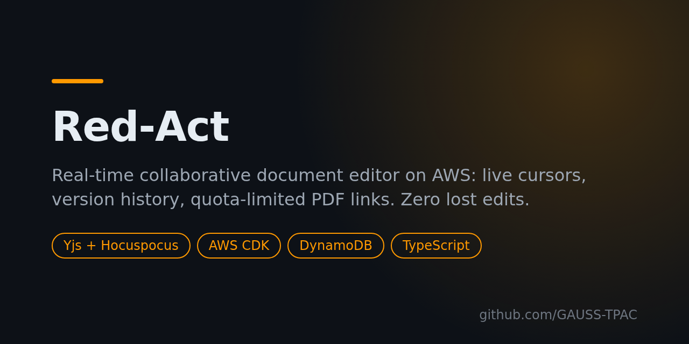

# Red-Act



[](LICENSE)
[](https://github.com/GAUSS-TPAC/Red-Act/releases)


🇫🇷 [Version française complète](README.fr.md)

A **real-time collaborative document editor** built to serve hundreds of writers and thousands of readers on AWS, with two hard guarantees, both covered by tests:

1. **No accepted edit is ever lost**, even when the real-time server is killed mid-session.
2. **A download link never serves one copy more than its quota**, even under 15,000 concurrent visitors.

A complete, production-style reference for **Yjs + Hocuspocus on AWS**, with infrastructure as code, load tests and a cost report.

## Features

- Rich-text editing with **live presence and cursors** (Yjs CRDT over WebSocket).
- **Version history** with snapshots in S3.
- **Quota-limited PDF links**: an atomic conditional decrement reserves each copy; the PDF is always up to date at click time.
- **Daily credit** of 10,000 characters per writer, enforced across devices.
- **Anti-abuse** rate limiting, admin dashboard, and an e-mail (SES) to the link creator at the last download.

## Architecture


```
Browser ──HTTPS──► CloudFront ──► ALB (CloudFront only)
                                   ├── /collab (WebSocket) ──► real-time server: Hocuspocus + Yjs, journal, compaction, PDF worker
                                   └── everything else ─────► stateless API (Auto Scaling 1–4, 2 AZs) + static front end
DynamoDB (8 tables, on-demand) · S3 (snapshots, PDFs, versioned) · SQS (PDF jobs) · SSM · SES · CloudWatch
```

An edit is **accepted** only once it is written to DynamoDB (journal + credit in one transaction); nothing is broadcast or confirmed before. Full rationale in the [design document](docs/dossier-conception.md) (French).

## Quick start (local, no AWS)

```bash
git clone https://github.com/GAUSS-TPAC/Red-Act.git && cd Red-Act
npm ci
npm run local:db   # DynamoDB Local in Docker, port 8000
npm run dev        # full app on http://localhost:3000 (admin token: "admin-local")
npm test           # unit, integration, scenario and CDK tests
```

## Deploy to AWS

Requires an IAM user with AWS CLI v2 (`eu-north-1`), Node.js 20 and `openssl`.

```bash
scripts/deploy.sh                                # creates secrets in SSM, bootstraps CDK, deploys
SES_SENDER=me@example.org scripts/deploy.sh      # with e-mail notifications
scripts/destroy.sh                               # removes everything
```

## Proof, not promises

| Guarantee | Test |
|---|---|
| Exact number of downloads | `npm run test:c1` |
| No lost edit, convergence (also with the server killed) | `npm run test:c2` |
| PDF up to date at click time | `npm run test:c3` |
| Daily credit across devices | `npm run test:c4` |

Raw results are in [`tests/results/`](tests/results/), the analysis in the [test report](docs/rapport-test.md), costs in [`docs/cout.md`](docs/cout.md), and the API in [OpenAPI](docs/openapi.yaml) and [WebSocket](docs/api-temps-reel.md) form.

## Contributing

Issues and pull requests are welcome. If this project helps you build a collaborative app on AWS, a ⭐ helps others find it.

## License

[MIT](LICENSE) © GAUSS-TPAC
