# Dossier de conception — Éditeur de documents partagé

Projet évalué AWS : application web d'écriture à plusieurs pour le journal d'une
association étudiante. Ce dossier décrit l'architecture, les choix et leurs
justifications, exigence par exigence, puis les limites assumées. Les preuves
chiffrées sont dans le [rapport de test](rapport-test.md), l'API dans
[openapi.yaml](openapi.yaml) (HTTP) et [api-temps-reel.md](api-temps-reel.md) (WebSocket),
le coût dans [cout.md](cout.md). Les diagrammes sont dans [`diagrammes/`](diagrammes/)
(sources Mermaid `.mmd`, modifiables, et images `.png`).

| Figure | Sujet | Section |
|---|---|---|
| 1 | Architecture de bout en bout | §2 |
| 2 | Réseau et sécurité | §2 |
| 3 | Déploiement | §2 |
| 4 | Modèle de données | §3 |
| 5 | Écriture à plusieurs (group commit) | §5.3 |
| 6 | États de l'éditeur et refus | §5.4 |
| 7 | Chargement, compaction, arrêt brutal | §5.5 |
| 8 | Clic sur un lien et génération du PDF | §6.1 |
| 9 | Cycle de vie d'un lien | §6.1 |
| 10 | Le pic autour de l'heure d'ouverture | §7.1 |
| 11 | Page de téléchargement côté visiteur | §7.2 |

## 1. Le besoin et les contraintes

Fonctions : créer un document et le partager à d'autres rédacteurs (éditeurs
uniquement) ; écrire à plusieurs en temps réel avec présence et curseurs, et mise en
forme (gras, italique, souligné, police, taille) ; historique des versions et
restauration ; liens de téléchargement PDF limités en nombre, toujours à jour, avec heure
d'ouverture optionnelle ; crédit de 10 000 caractères par jour ; blocage des personnes
qui s'acharnent ; tableau de bord de l'association ; e-mail au créateur d'un lien à son
dernier téléchargement. Identité : un nom et une adresse e-mail saisis à l'entrée (pas de
vrais comptes) ; visiteurs anonymes.

Le sujet impose six exigences, rappelées ci-dessous dans l'ordre de l'énoncé ; les deux
premières sont éliminatoires. Dans la suite, chacune est désignée par son nom.

| Exigence | Ce que demande le sujet | Où elle est tenue |
|---|---|---|
| **Nombre exact de téléchargements** (éliminatoire) | Un lien autorise exactement N téléchargements, jamais un de plus | §6.1 : décrément atomique conditionnel DynamoDB |
| **Aucune modification perdue** (éliminatoire) | Aucune modification acceptée n'est perdue ; tous convergent | §5 : CRDT Yjs + écriture DynamoDB **avant** diffusion |
| **PDF à jour au moment du clic** | Un lien utilisé à T1 donne le document tel qu'à T1 | §6.2 : `seq` lu au clic, PDF à `pdfSeq ≥ seqRequis` |
| **Crédit quotidien d'écriture** | Jamais plus que le crédit du jour, même depuis plusieurs appareils | §5.4 : débit conditionnel dans la même transaction que le journal |
| **Tenue du pic d'affluence** | 15 000 visiteurs (80 % en 1 min) pendant que 300 rédacteurs écrivent | §7 : API sans état + montée programmée, 410 en mémoire |
| **Annonce rapide de l'épuisement** | Après le dernier exemplaire, les visiteurs l'apprennent vite, sans solliciter les services | §7.3 : mémoire « épuisé » par instance, arrêt du client au 410 |

Cadre : compte AWS en plan gratuit (100 $ de crédits), une seule région (eu-north-1),
infrastructure en CDK, aucun secret dans le code.

## 2. Architecture

Le navigateur passe toujours par CloudFront, qui transmet tout à un équilibreur de
charge (ALB). L'ALB envoie la connexion d'écriture (`/collab`, WebSocket) au serveur temps
réel, et tout le reste (API, pages, fichiers du front) aux instances API. Le serveur
temps réel écrit les modifications ; l'API gère les documents, les liens et les
téléchargements. Les deux partagent DynamoDB et S3, et communiquent par une file SQS pour
les demandes de PDF.

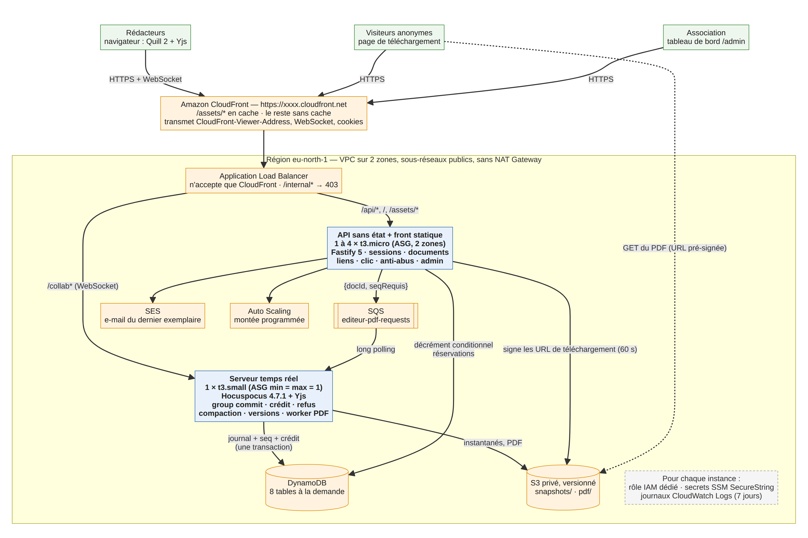

*Figure 1 — Architecture de bout en bout.*

**Réseau.** VPC sur 2 zones, sous-réseaux publics, **pas de NAT Gateway** (≈ 35 $/mois
évités). Les instances ont une IP publique mais leurs groupes de sécurité n'acceptent que
l'ALB ; l'ALB n'accepte que la liste de préfixes gérée de CloudFront. Points de
terminaison VPC *gateway* (gratuits) pour S3 et DynamoDB. Aucun port 22 : l'accès aux
instances se fait par SSM Session Manager.

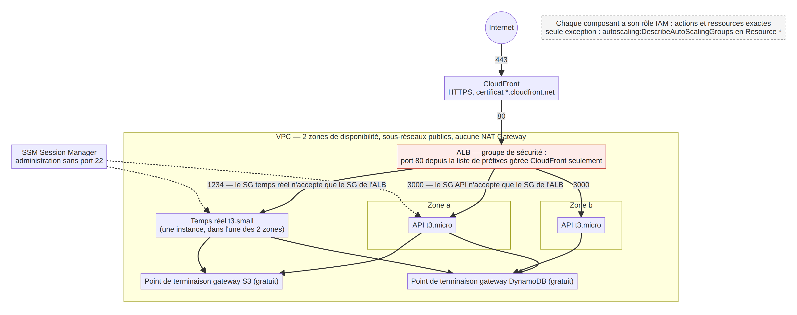

*Figure 2 — Réseau et sécurité : qui peut parler à qui.*

**HTTPS sans nom de domaine.** CloudFront fournit `*.cloudfront.net` avec son certificat :
aucun certificat ACM, aucun domaine à acheter. CloudFront est un service global sans
données ; toutes les ressources régionales sont en eu-north-1.

**Déploiement du code.** esbuild produit un bundle par serveur (`server.cjs`, plus
`pdf-worker.cjs`) et le front (fichiers à empreinte). Ils sont publiés comme assets CDK
(S3) ; le *user data* Amazon Linux 2023 installe Node 20, récupère le bundle grâce au rôle
de l'instance et lance un service systemd sous un utilisateur sans droits. Aucun
`npm install` sur les instances. Journaux : agent CloudWatch vers `/editeur/api` et
`/editeur/realtime` (rétention 7 jours).

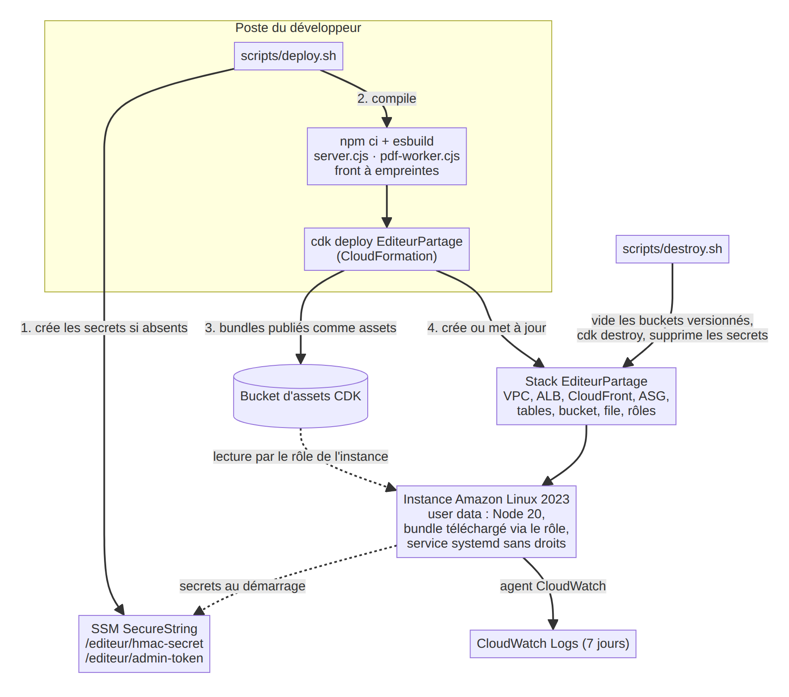

*Figure 3 — Déploiement : du dépôt aux instances.*

**Pourquoi un seul serveur temps réel.** 300 rédacteurs, c'est peu : une instance
t3.small tient la charge (mesuré, §8 du rapport). Une autorité unique par document évite
les verrous distribués et Redis (coût, complexité). Elle est dans un ASG min = max = 1 qui
la relance seule en cas de panne. Sa mise à jour arrête l'ancienne instance **avant** de
lancer la nouvelle (`minInstancesInService: 0`, `maxBatchSize: 1`) : jamais deux serveurs
qui écrivent le même document. Prix assumé : un point unique de défaillance, soit
quelques dizaines de secondes de reconnexion lors d'une panne ou d'une mise à jour, sans
perte de ce qui a été accepté (§5.5). Évolution possible : plusieurs serveurs répartis par
document, avec Redis pour la présence.

## 3. Données (DynamoDB, mode à la demande)

| Table | Clé | Attributs principaux | TTL |
|---|---|---|---|
| `Documents` | `docId` | `title`, `ownerEmail`, `editors` (ensemble), `seq`, `pdfSeq`, `snapshotSeq`, `snapshotKey`, `activeLinkId` | — |
| `Journal` | `docId` + `seq` | `update` (binaire Yjs fusionné), `authors`, `createdAt` | 7 j |
| `Credits` | `pk = email#AAAA-MM-JJ` | `used` | 2 j |
| `Links` | `linkId` | `docId`, `creatorEmail`, `max`, `remaining`, `opensAt`, `status`, `activeFlag` (index creux `liens-actifs`), `closedRemaining` | — |
| `Reservations` | `reservationId` | `linkId`, `docId`, `seqRequis`, `url`, `urlExpiresAt`, `pdfKey` | 1 h |
| `Blocks` | `subject` (`writer#email` / `ip#adresse`) | `reason`, `expireLe` | après `expireLe` |
| `Presence` | `docId` | `title`, `connected`, `lastBeat` | 2 min |
| `Versions` | `docId` + `createdAt` | `snapshotKey`, `seq`, `label`, `author` | — |

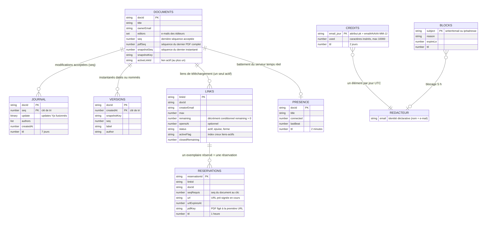

*Figure 4 — Modèle de données (DynamoDB et S3).*

Le mode à la demande suit la charge sans réglage et ne coûte rien au repos. Aucune table
n'est lue par un *scan* sur un chemin chaud : les listes de documents d'un rédacteur et de
liens d'un document sont des *scans* filtrés, acceptables à l'échelle d'une association
(quelques dizaines d'éléments) ; une table d'appartenance les remplacerait au besoin.

S3 : `snapshots/{doc}/{seq}.bin` (états Yjs complets) et `pdf/{doc}/{seq}.pdf`. Bucket
privé (Block Public Access), chiffré, HTTPS obligatoire, **versionné** (filet de sécurité)
avec cycle de vie : versions non courantes supprimées après 30 jours, PDF après 1 jour
(un PDF ne sert que le temps des téléchargements).

## 4. Identité, sessions, secrets

- Entrée : `POST /api/session {name, email}` ; e-mail normalisé (minuscules, sans
  espaces) ; jeton HMAC-SHA256 `{email, name, exp: 24 h}`. Vérifié à chaque requête API
  et dans `onAuthenticate` de Hocuspocus, qui contrôle aussi que l'e-mail est éditeur du
  document.
- Secrets : `/editeur/hmac-secret` et `/editeur/admin-token` en SSM SecureString, créés par
  `scripts/deploy.sh` (aléatoires, jamais affichés ni versionnés), lus au démarrage par les
  rôles des instances.
- IAM : un rôle par composant, actions et ressources exactes (tables, préfixes S3, file
  SQS, paramètres SSM, groupe de journaux, ASG). Seule exception :
  `autoscaling:DescribeAutoScalingGroups` en `Resource: *`, action de lecture que AWS ne
  permet pas de restreindre, nécessaire au seuil anti-abus (§9). Un test CDK vérifie
  qu'aucune autre action n'a `Resource: *`.
- Limite (conséquence du sujet) : sans vrais comptes, changer d'adresse e-mail contourne le
  crédit et le blocage d'un rédacteur ; le blocage par adresse IP des visiteurs freine
  partiellement.

## 5. Écriture en temps réel — aucune modification perdue

### 5.1 CRDT

Le contenu d'un document est un `Y.Text` Yjs. Yjs est un CRDT : toutes les copies qui ont
reçu le même ensemble de modifications sont identiques, quel que soit l'ordre d'arrivée,
y compris quand deux personnes écrivent au même endroit. La convergence est donc
garantie par construction ; le travail porte sur **ne rien perdre** de ce qui a été
accepté.

### 5.2 Définition et ordre des opérations

Une modification est **acceptée** quand elle est écrite dans DynamoDB. Ordre imposé :
écriture → application à la copie de référence → diffusion aux autres → confirmation à
l'auteur. Une modification confirmée est donc toujours dans le journal.

Vérification faite dans le code de Hocuspocus 4.7.1 (`MessageReceiver.readSyncMessage`) :
le hook asynchrone `beforeSync` est attendu **avant** l'application d'un update. On y
retient chaque update jusqu'à la fin de l'écriture ; lever une erreur ferme la connexion
au document. C'est ce qui a permis de garder Hocuspocus plutôt que d'écrire un serveur
WebSocket maison.

### 5.3 Group commit par document

Une écriture par frappe et par rédacteur serait trop coûteuse et créerait des conflits
sur l'élément du document. Chaque document a donc sa boucle d'écriture :

1. une seule transaction à la fois par document, lancée dès que la précédente est finie,
   avec au moins 100 ms entre deux débuts ;
2. tout ce qui arrive pendant la transaction en cours, de tous les rédacteurs, est
   fusionné (`Y.mergeUpdates`) en **un seul élément de journal** ;
3. `TransactWriteItems` : Put journal `{docId, seq+1}` (absent) + Update document
   `seq = seq+1` (si `seq` vaut la valeur attendue) + pour chaque rédacteur un Update de
   crédit `used += n` si `used + n ≤ 10 000` ;
4. au-delà de 98 rédacteurs dans un lot (limite de 100 actions), découpage en
   transactions successives, un même rédacteur restant dans une seule ;
5. échec : `CancellationReasons` désigne le rédacteur dont le crédit manque, ses updates
   sont refusés et la transaction repart pour les autres ; un `TransactionConflict`
   (même crédit débité pour un autre document au même instant) est réessayé avec un
   délai aléatoire, sans rien refuser ;
6. succès : application à la copie de référence (diffusion), puis confirmation `ack(seq)`.

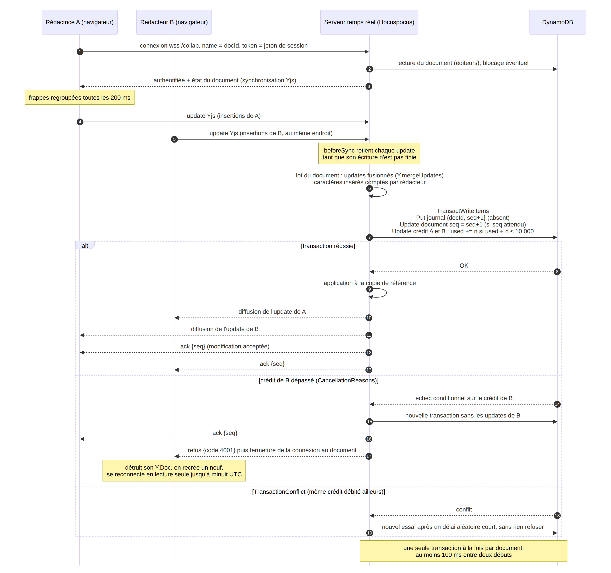

*Figure 5 — Écriture à plusieurs : rien n'est diffusé ni confirmé avant l'écriture DynamoDB.*

Une fenêtre fixe de 300 ms, prévue au départ, limitait chaque rédacteur à environ 3
frappes/s, car Hocuspocus traite les messages d'une connexion un par un : d'où la boucle
« dès que possible ».

**Regroupement côté client.** Pour la même raison, à 8 frappes/s et un message par frappe,
les messages d'un rédacteur font la queue derrière les transactions (retard médian
d'environ 1,1 s sur AWS, rapport §3). L'éditeur envoie donc ses frappes groupées toutes
les 200 ms (`flushDelay` natif du provider Hocuspocus), comme prévu dans ce cas.

### 5.4 Crédit quotidien d'écriture

Seuls les caractères **insérés** comptent : le serveur décode l'update, ne garde que ce
qu'il n'a pas encore (`diffUpdate` contre son vecteur d'état, pour ne pas débiter deux
fois une resynchronisation) et additionne la longueur des contenus texte. Les suppressions
et la mise en forme ne comptent pas. Le débit est conditionnel et dans la **même
transaction** que le journal : deux appareils du même rédacteur, même sur deux documents,
débitent le même élément `credit#email#jour` ; DynamoDB sérialise les deux transactions,
la seconde échoue si elle dépasserait 10 000. Un nouveau jour UTC est une nouvelle clé :
pas de remise à zéro, l'ancienne clé disparaît par TTL.

Tout contenu qui n'est ni du texte ni un format autorisé (objets, images, sous-documents,
attributs inconnus) est refusé : il permettrait de contourner le décompte ou de produire
un PDF faux.

**Refus** : le serveur envoie un message `refus` puis ferme la
connexion au document avec un code (4001 crédit épuisé, 4003 rédacteur bloqué). Le
client **détruit son Y.Doc** (qui contient la modification refusée) et en crée un neuf
avant de se reconnecter. Après 4001 : lecture seule jusqu'à minuit UTC, les modifications
des autres restent visibles. Après 4003 : aucune reconnexion avant la fin du blocage,
dont l'heure est affichée. Hocuspocus 4 ne transmet au client que la raison de fermeture
(code toujours 1000, une socket portant plusieurs documents) : le code voyage donc dans
le message `refus` et dans la raison.

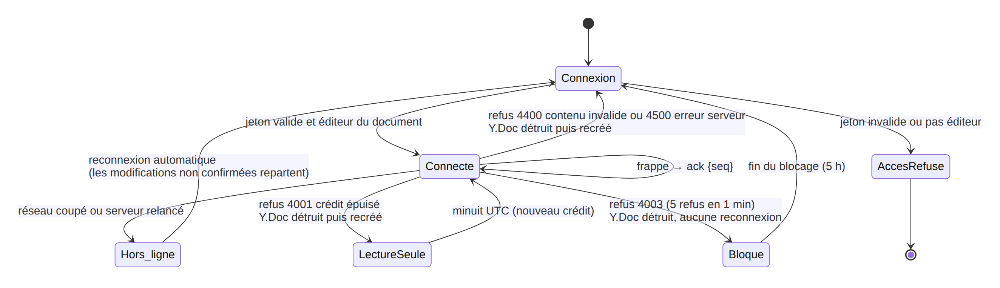

*Figure 6 — États de l'éditeur : connexion, refus, lecture seule, blocage.*

### 5.5 Chargement, compaction, arrêt brutal

- Chargement d'un document : dernier instantané S3 + éléments du journal de
  `seq > snapshotSeq`, lus en lecture fortement cohérente et bornés à `seq` ; un trou dans
  le journal fait refuser le chargement plutôt que servir un état incomplet.
- Compaction (tous les 500 éléments ou 5 min d'activité, et au déchargement) : état
  fusionné → S3 → pointeur `snapshotSeq` avancé par écriture conditionnelle. Les éléments
  du journal expirent par TTL (7 jours) ; pas de suppression unitaire. Une panne au milieu
  ne perd rien : l'instantané est idempotent et le journal reste la référence.
- Arrêt brutal de l'instance : ce qui est confirmé est dans DynamoDB. L'ASG relance une
  instance qui compacte au démarrage les documents en retard. Les clients se reconnectent
  et renvoient ce qui n'avait pas été confirmé ; Yjs ignore ce qui est déjà connu.
  Ce scénario a été provoqué sur AWS le 26/10 : 26 354 frappes, aucune perdue (rapport §3).

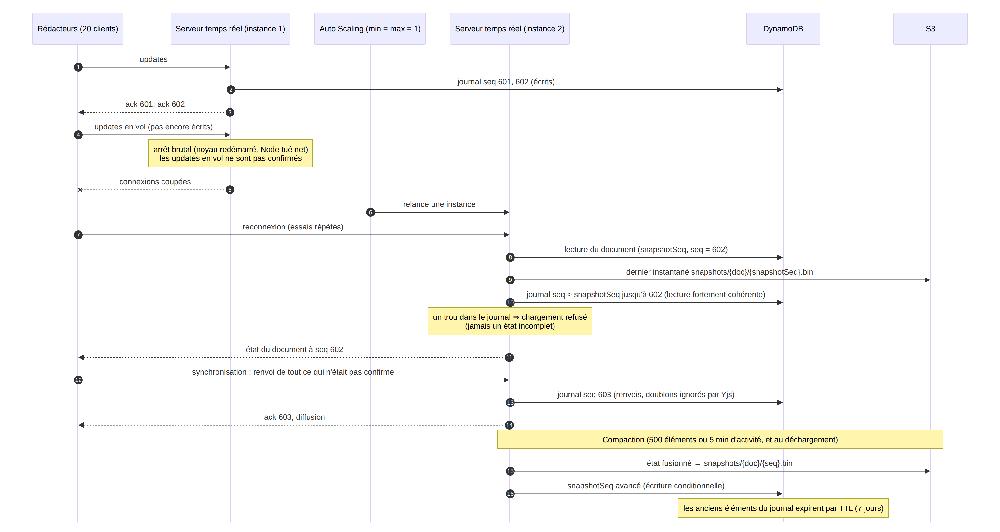

*Figure 7 — Chargement, compaction et reprise après un arrêt brutal.*

### 5.6 Versions et mise en forme

- Versions : chaque instantané de compaction est une version datée ; le bouton
  « enregistrer la version actuelle » crée un instantané immédiat nommé. Une fenêtre
  permet de parcourir les versions avec un **aperçu** en lecture seule avant de
  restaurer. Restaurer applique l'ancien contenu (texte et mise en forme) comme une
  **nouvelle modification**, écrite dans le journal comme toute autre ; on ne revient
  jamais en arrière dans le CRDT. Une restauration ne consomme pas de crédit.
- Mise en forme : l'éditeur est Quill 2 lié au même `Y.Text`
  par `y-quill` ; les formats sont des attributs du texte. Seuls existent gras, italique,
  souligné, trois polices et quatre tailles (`FORMATS`), choisis pour être reproduits
  exactement dans le PDF avec les 12 polices standard de pdfkit (Helvetica, Times,
  Courier, en romain, gras, italique et gras italique), sans fichier de police à
  embarquer. Les documents existants (texte brut dans le même `Y.Text`) restent
  compatibles.

## 6. Liens de téléchargement et PDF

### 6.1 Le clic : nombre exact de téléchargements

`POST /api/links/:linkId/claim`, dans cet ordre :

1. **Ticket** valide (cookie signé HMAC, 2 min) → on relit la réservation et on délivre
   (URL enregistrée si elle n'a pas expiré ; sinon nouvelle URL sur le **même** PDF,
   substituée par écriture conditionnelle : une seule URL valide à la fois). Le ticket
   passe avant la mémoire « épuisé » : sinon le détenteur du dernier exemplaire recevrait
   un 410.
2. Lien connu épuisé par cette instance → **410** immédiat, sans DynamoDB.
3. Avant `opensAt` → **425** avec `opensAt` et `Retry-After` (5 à 62 s, avec une part
   aléatoire pour étaler les retours).
4. Sinon : lecture fortement cohérente de `seq` du document, puis **décrément atomique
   conditionnel** du lien : `remaining = remaining − 1` à condition que `remaining > 0`
   (et que l'ouverture soit passée). DynamoDB exécute ces mises à jour une par une sur
   l'élément : quelle que soit la concurrence, au plus `max` décréments réussissent.
   Échec conditionnel → « épuisé » mémorisé → 410. Succès → réservation
   `{reservationId, linkId, docId, seqRequis}`, cookie ticket, puis 200 (URL pré-signée de
   60 s) si `pdfSeq ≥ seqRequis`, sinon 202 + `Retry-After` et demande de génération.
5. Le décrément qui fait passer le stock à 0 est **unique** : c'est lui qui marque le lien
   épuisé et envoie l'e-mail SES au créateur, une seule fois par construction.

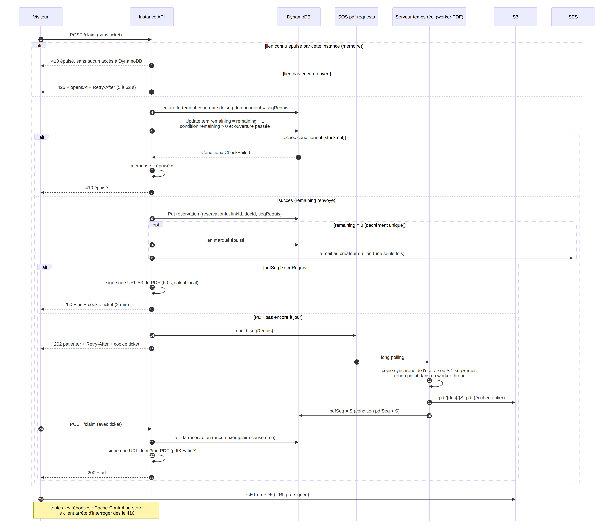

*Figure 8 — Clic sur un lien et génération du PDF.*

Toutes les réponses de téléchargement portent `Cache-Control: no-store`, et CloudFront ne
met pas en cache les routes d'API : un 410 en cache servi à un détenteur de ticket serait
faux.

**Un seul lien actif par document** : le lien et le pointeur
`activeLinkId` du document sont écrits dans une transaction conditionnelle (« pas de lien
actif ») ; deux créations simultanées → une seule réussit, l'autre reçoit 409 avec le lien
existant. Un rédacteur peut **fermer** un lien : stock remis à 0 en une écriture atomique
(les clics suivants reçoivent 410), document libre pour un nouveau lien. Une réservation
encore en attente du PDF (202) au moment de la fermeture est honorée ; un exemplaire déjà
remis ne peut plus être retéléchargé avec le ticket (410). Seule l'URL S3 déjà donnée
reste valable jusqu'à son expiration (60 s). Si le lien avait une heure d'ouverture, la
fermeture retire aussi la montée programmée (`BatchDeleteScheduledAction`, qui tolère une
action déjà exécutée) et avance la descente à dans une minute : l'ASG API revient au
minimum, que le pic ait commencé ou non. Le clic, chemin critique du décompte des exemplaires, ne touche pas au
document : un pointeur vers un lien épuisé est libéré paresseusement à la création suivante.

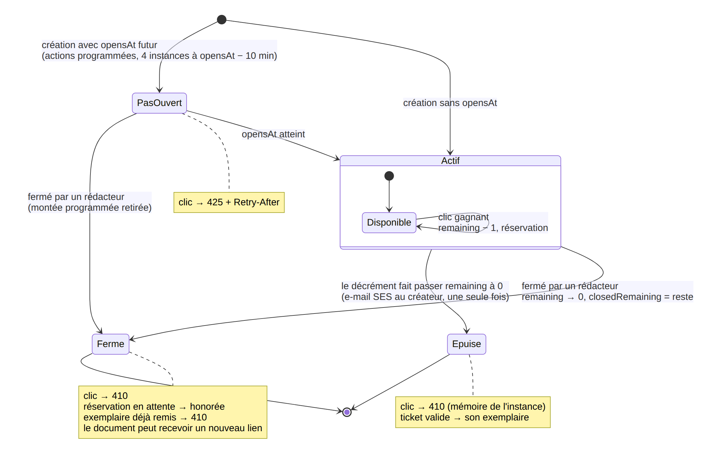

*Figure 9 — Cycle de vie d'un lien.*

**Pourquoi pas une transaction décrément + réservation.** Le décrément et la création de
la réservation sont deux écritures. Une panne de l'instance entre les deux (quelques
millisecondes) consommerait un exemplaire sans réservation : un téléchargement de
**moins**, jamais un de plus. Une transaction les rendrait atomiques, mais deux
transactions ne peuvent pas toucher le même élément en même temps (`TransactionConflict`),
contrairement aux `UpdateItem` que DynamoDB sérialise : au pic (≈ 200 clics/s sur un seul
lien), cela produirait des conflits en masse et doublerait le coût d'écriture. Nous gardons
donc l'`UpdateItem` conditionnel et assumons ce cas de panne.

### 6.2 Génération des PDF : document à jour au moment du clic

- Garantie : le PDF obtenu par un visiteur qui clique à T1 contient au moins toutes les
  modifications acceptées avant T1 (il peut en contenir de plus récentes).
- Au clic, `seqRequis = seq` du document (lecture fortement cohérente). L'API demande un
  PDF par la file SQS `editeur-pdf-requests` `{docId, seqRequis}` (choisie pour le
  découplage, aucune route interne, IAM par composant), en amortissant ses envois (une
  demande par document sauf séquence plus récente ou plus de 5 s écoulées).
- Le serveur temps réel lit la file en *long polling* et fait **une génération à la fois
  par document** : copie **synchrone** du texte, de sa mise en forme et de `seq = S`
  (aucun commit ne peut s'intercaler), rendu pdfkit dans un *worker thread* (la boucle
  d'événements reste libre pour les rédacteurs), écriture S3 `pdf/{doc}/{S}.pdf`, **puis**
  bascule `pdfSeq = S` par écriture conditionnelle `pdfSeq < S`. Un PDF à moitié écrit
  n'est jamais visible ; `pdfSeq` ne recule jamais ; une génération sert toutes les
  demandes antérieures.
- À la création d'un lien, le PDF de l'état actuel est préparé tout de suite : si personne
  n'écrit, les premiers clics reçoivent directement 200.
- Une réservation fige son PDF (`pdfKey`) à sa première URL : une URL renouvelée pointe sur
  le même fichier.

## 7. Le pic d'affluence

### 7.1 Capacité

- L'API est sans état : tout ce qui doit être partagé est dans DynamoDB. Elle passe à
  l'échelle horizontalement (ASG 1 à 4 × t3.micro sur 2 zones).
- **Montée programmée** : à la création d'un lien avec `opensAt`, l'API crée deux actions
  programmées sur son propre ASG : 4 instances à `opensAt − 10 min`, retour au minimum à
  `opensAt + 15 min`. Le nom de l'ASG est lu dans les étiquettes de l'instance (IMDSv2),
  et le rôle ne peut agir que sur cet ASG.
- **Scaling réactif** en filet (3 000 requêtes/min par instance), seul actif pour un lien
  sans `opensAt` (limite à connaître : une instance met 2 à 3 minutes à démarrer).
- Élément chaud : ≈ 200 décréments/s sur un seul lien, sous la limite d'environ 1 000
  écritures/s d'une partition DynamoDB.

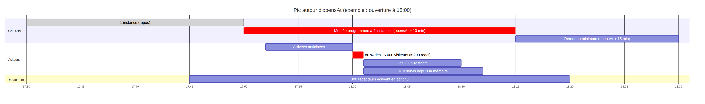

*Figure 10 — Le pic autour de l'heure d'ouverture (exemple : 18:00).*

### 7.2 Chaque visiteur reçoit une réponse

La page de téléchargement a trois états visibles : **télécharge** (200), **patiente**
(202 réservé, 425 pas encore ouvert, ou erreur passagère 5xx : nouvel essai avec délai
croissant), **épuisé** (410). Seul un lien inconnu (404) arrête la page sans état final.

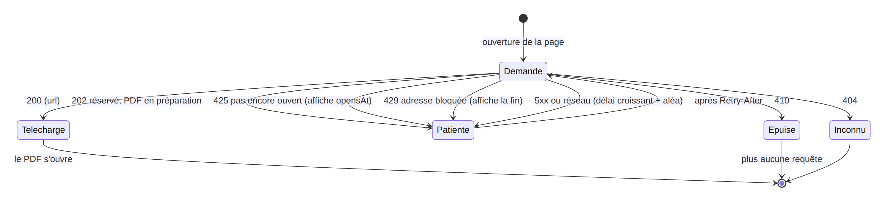

*Figure 11 — Page de téléchargement : chaque visiteur reçoit une réponse.*

### 7.3 Après le dernier exemplaire : annonce rapide de l'épuisement

Pas de *push* : les visiteurs interrogent avec `Retry-After`. Chaque instance API mémorise
les liens épuisés : un 410 est servi **sans aucun accès à DynamoDB** (10 ms au 95ᵉ
centile au test de charge), et le client **cesse d'interroger** dès le 410. Le coût du
« vite » est donc borné : un aller-retour par visiteur encore présent, servi depuis la
mémoire.

## 8. Anti-abus

- **Rédacteur** : 5 refus (4001/4003) en 1 minute → blocage de 5 h, écrit dans `Blocks`
  (relu à la connexion, pour survivre à un redémarrage). Un rédacteur bloqué peut toujours
  **lire** le document ; seules ses modifications sont refusées.
- **Visiteur** : compteur **en mémoire** par instance API et par adresse IP, fenêtre de
  10 s, seuil 30/N (N = instances en service, relu toutes les 30 s) : l'ALB répartit les
  requêtes, chaque instance voit environ 1/N du trafic d'une adresse. Aucune écriture par
  requête normale ; un dépassement écrit un blocage de 10 min, partagé avec les autres
  instances à leur synchronisation. L'adresse vient de `CloudFront-Viewer-Address`, jamais
  de `X-Forwarded-For` (falsifiable). Les rappels d'un visiteur qui a déjà réservé (ticket
  valide) ne sont pas comptés.
- **Limite assumée — NAT partagé** : derrière le NAT d'un campus ou d'un opérateur mobile,
  plusieurs visiteurs légitimes partagent une adresse ; quelques visiteurs qui rappellent
  au même rythme peuvent franchir le seuil. Le blocage est court (10 min), le `Retry-After`
  du 425 est d'au moins 5 s avec une part aléatoire, et les rappels avec ticket ne
  comptent pas, ce qui réduit ce risque sans le supprimer. Le test de charge part d'une
  seule machine, dont l'adresse est exemptée pendant le test (paramètre SSM
  `/editeur/charge-ip`) : il n'a pas exercé ce chemin.
- Alternative au `DescribeAutoScalingGroups` : chaque instance écrit un battement dans
  DynamoDB et N = nombre de battements récents (pas d'exception IAM, une lecture toutes les
  30 s).

## 9. Tableau de bord, e-mail

- `/admin` : jeton d'administration (SSM) comparé à temps constant, rafraîchissement toutes
  les 5 s. Documents ouverts (battement du serveur temps réel toutes les 30 s, TTL),
  liens actifs et exemplaires restants (index creux `liens-actifs`, présent seulement sur
  les liens actifs), blocages en cours (filtrés sur `expireLe > maintenant`, le TTL
  supprimant avec retard).
- E-mail : SES en bac à sable, expéditeur vérifié passé en contexte CDK (`sesSender`) ;
  envoyé une seule fois, par le décrément qui prend le dernier exemplaire. En bac à sable,
  les destinataires doivent aussi être vérifiés.

## 10. Coût (résumé, détail dans cout.md)

Choix guidés par le coût : pas de NAT Gateway, pas de Redis, un seul serveur temps réel,
DynamoDB à la demande, instances t3 du niveau gratuit, PDF supprimés après 1 jour,
journaux gardés 7 jours, instance de test de charge créée puis détruite pour chaque test.

## 11. Limites assumées et évolutions

| Limite | Conséquence | Évolution possible |
|---|---|---|
| Un seul serveur temps réel | Quelques dizaines de secondes de reconnexion à une panne ou mise à jour ; rien d'accepté n'est perdu | Plusieurs serveurs répartis par document + Redis |
| Identité déclarative (sujet) | Changer d'e-mail contourne crédit et blocage | Connexion par lien magique e-mail |
| Panne entre décrément et réservation | Un exemplaire de moins (jamais un de plus) | Réservation préalable « en attente » puis décrément |
| Exemplaire perdu si le visiteur part après réservation | Pas de remise en stock | Remise en stock à l'expiration du ticket |
| URL pré-signée réutilisable 60 s | Partage possible pendant 60 s | Téléchargement servi par l'API |
| Seuil anti-abus par IP | Visiteurs derrière un même NAT bloqués 10 min | Défi (captcha) au lieu d'un blocage |
| Polices du PDF | Encodage WinAnsi : pas d'emoji ni d'écritures non latines | Polices TrueType embarquées |
| Lien sans `opensAt` | Seul le scaling réactif joue (2 à 3 min) | Capacité minimale plus haute pendant la publication |
| Mise à jour de l'API sans attente de santé | Pendant un déploiement, courte fenêtre (≈ 2 min observées le 26/10) où la nouvelle instance API n'est pas encore saine | Mise à jour progressive avec `minInstancesInService: 1` et signaux de démarrage |

## 12. Écarts par rapport aux décisions initiales

| Décision initiale | Réalisé | Raison |
|---|---|---|
| Fenêtre fixe de 300 ms par document | Transaction dès que possible, ≥ 100 ms entre deux | Hocuspocus traite les messages d'une connexion un par un : 300 ms limitaient chaque rédacteur à ~3 frappes/s |
| Une frappe = un message | Regroupement côté client 200 ms | Retard médian ≈ 1,1 s sur AWS à 8 frappes/s sans regroupement |
| Éditeur CodeMirror (texte brut) | Quill 2 + y-quill (mise en forme) | Retour après essai de l'application (26/10) ; même `Y.Text`, formats limités et reproduits dans le PDF |
| Plusieurs liens par document | Un seul lien actif, fermeture possible | Retour après essai de l'application (26/10) : plusieurs liens pour un même document prêtaient à confusion |
| URL de réservation : jamais une nouvelle | Nouvelle URL sur le même PDF si l'ancienne a expiré | Un visiteur dont l'URL a expiré pendant le téléchargement doit pouvoir réessayer ; toujours une seule URL valide |
